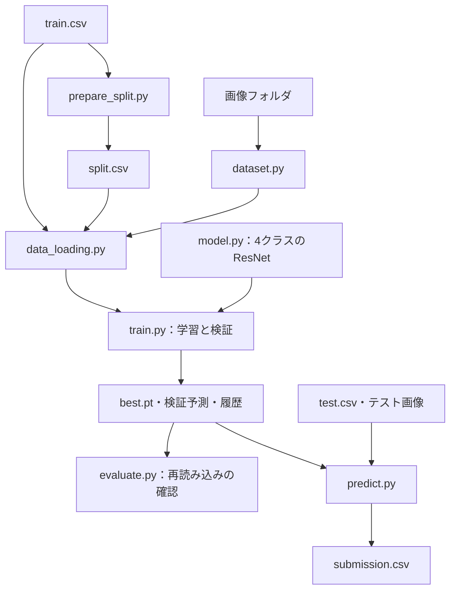

# 11: コードを読む順番と、各処理の意味

この資料は、このリポジトリのコードを使って「画像を読み、モデルを学習させ、未知の画像を予測する」流れを理解するためのものです。
まずResNet18の動作を読みます。ResNet34・50への切り替えは、基本の流れを理解した後で構いません。
コード中の関数名・変数名を見出しや表に残しているので、実際のファイルと並べて読んでください。

## 目次

1. [最初に読むファイルと全体像](#1-最初に読むファイルと全体像)
2. [データの形とPythonの書き方](#2-データの形とpythonの書き方)
3. [dataset.py：画像1枚を取り出す](#3-datasetpy画像1枚を取り出す)
4. [prepare_split.py：学習と検証を分ける](#4-prepare_splitpy学習と検証を分ける)
5. [data_loading.py：画像をバッチにまとめる](#5-data_loadingpy画像をバッチにまとめる)
6. [model.py：ResNetを作る・保存した重みを戻す](#6-modelpyresnetを作る保存した重みを戻す)
7. [train.py：学習・検証・保存](#7-trainpy学習検証保存)
8. [evaluate.py：保存モデルの再現を確認する](#8-evaluatepy保存モデルの再現を確認する)
9. [predict.py：テスト画像を予測してCSVを作る](#9-predictpyテスト画像を予測してcsvを作る)
10. [補助コードと保存ファイル](#10-補助コードと保存ファイル)
11. [実行の順番と理解の確認](#11-実行の順番と理解の確認)

## 1. 最初に読むファイルと全体像

### 優先して理解する7ファイル

| 読む順番 | ファイル | 入力 | 出力・役割 |
| --- | --- | --- | --- |
| 1 | [dataset.py](../dataset.py) | CSV由来の表、画像フォルダ | 画像1枚とクラス番号、または画像ID |
| 2 | [prepare_split.py](../prepare_split.py) | train.csv | 学習用・検証用の割り当てsplit.csv |
| 3 | [data_loading.py](../data_loading.py) | train.csv、split.csv、画像 | 学習用・検証用DataLoader |
| 4 | [model.py](../model.py) | モデル名、学習済み重みの指定 | 4クラスを出力するモデル |
| 5 | [train.py](../train.py) | 学習条件、DataLoader、モデル | 学習履歴、最良重み、検証予測 |
| 6 | [evaluate.py](../evaluate.py) | 保存重みと学習時の記録 | 保存前後の予測が一致するかの確認 |
| 7 | [predict.py](../predict.py) | 保存重み、test.csv、テスト画像 | Kaggle提出用の予測確率CSV |

`dataset.py`、`data_loading.py`、`model.py`は、主に他のファイルから読み込む部品です。
`train.py`などの末尾にある`main()`が、これらの部品を組み合わせて動かします。



学習に使う正解付き画像、検証に使う正解付き画像、正解が非公開のテスト画像は区別します。
検証でモデルの重みは更新しません。ただし、最良エポックを選ぶ判断には使います。

## 2. データの形とPythonの書き方

### 処理中の形

`B`はそのバッチの画像枚数です。最後のバッチでは32枚未満になることがあります。

| 場所・変数 | 形・型 | 意味 |
| --- | --- | --- |
| CSVのラベル | healthy等4列の0/1 | 1になった列が正解クラス |
| Datasetの画像 | `[3, 224, 224]`、float32 | 色チャンネル・高さ・幅の順 |
| Datasetのlabel | Pythonのint | 0〜3のクラス番号 |
| バッチのimages | `[B, 3, 224, 224]` | B枚分を先頭の次元にまとめたTensor |
| バッチのlabels | `[B]`、int64 | B枚それぞれの正解番号 |
| logits | `[B, 4]`、浮動小数 | モデルが出す、確率にする前の値 |
| loss | スカラーTensor | バッチの平均損失。逆伝播に使う |
| probabilities | `[B, 4]` | softmax後の4クラスの確率 |
| 検証のall_probabilities | `[365, 4]` | 全検証画像の確率 |
| 提出用の表 | 1821行・5列 | image_idと4クラスの確率 |

クラス番号は全ファイルで次の順番です。

```python
CLASS_NAMES = ["healthy", "multiple_diseases", "rust", "scab"]
#                 0              1             2       3
```

`multiple_diseases`は今回の4択の中の1クラスです。このデータでは1枚の正解を1クラスに変換します。
複数の独立した正解を同時に付けるマルチラベル分類としては実装していません。

### コード全体で共通する書き方

| 書き方 | 意味 |
| --- | --- |
| `import torch` | PyTorchの機能を使えるようにする |
| `from model import build_model` | 自分で作ったmodel.pyの関数を読み込む |
| `Path("data") / "train.csv"` | OSに合う形でファイルのパスを組み立てる。数値の割り算ではない |
| `class ...`、`self` | データと処理をまとめるクラスと、その個別の実体 |
| `def ...`、`return ...` | 処理に名前を付け、結果を呼び出し元へ返す |
| `with ... as ...` | ファイルを閉じる処理などを、ブロック終了時に行う |
| `if ...: raise ValueError(...)` | 条件違反を見つけ、誤った結果を作る前に止める |
| `enumerate(..., start=1)` | 値と、その1始まりの番号を順に取り出す |
| `for ... in ...` | 要素を順に処理する |
| `[式 for ... in ...]` | 繰り返しからリストを作る。辞書の場合は`{キー: 値 for ...}` |
| `**辞書` | 辞書の中身を別の辞書などへ展開する |
| `f"Epoch {epoch}"` | 文字列中に変数の値を埋め込む |
| `if __name__ == "__main__": main()` | このファイルを直接実行したときだけmainを動かす。import時には動かさない |
| `argparse` | `--epochs 5`など、実行時の指定をPythonの変数に変える |
| `json.dumps(..., ensure_ascii=False, indent=2)` | 辞書を、読みやすい日本語付きJSON文字列にする |
| `hashlib.sha256(...).hexdigest()` | ファイルの内容を照合する文字列を作る。モデルの学習処理ではない |

## 3. dataset.py：画像1枚を取り出す

### importとCLASS_NAMES

`PIL.Image`は画像を開くため、`torch.utils.data.Dataset`はPyTorchの読み出し規約を使うために読み込みます。
`CLASS_NAMES`は、CSVの列・モデルの出力・提出CSVを同じ順番で結び付ける定数です。

### PlantDataset.__init__：準備は一度だけ

| コード・変数 | 処理の意味 |
| --- | --- |
| `dataframe.reset_index(drop=True).copy()` | 分割後の行番号を0から振り直し、元の表に影響しないコピーを持つ |
| `self.image_dir = Path(image_dir)` | 画像の保存先を記憶する |
| `self.transform = transform` | 画像に適用する処理を受け取って記憶する。この時点では画像は変換しない |
| `dataframe[CLASS_NAMES].to_numpy()` | 指定した列順でラベルをNumPy配列にする |
| `((labels == 0) \| (labels == 1)).all()` | 全要素が0または1か調べる。`\|`は配列に対する「または」 |
| `sum(axis=1) == 1` | 各画像の4列の合計が1か調べ、正解が一つだけであることを確認する |
| `argmax(axis=1)` | 各行で最大値になる列番号を求める。`[0,0,0,1]`なら3 |

ラベルの検査より先にargmaxすると、不正な行でもクラス番号が出てしまいます。
`__init__`では画像を全枚数メモリに読み込まず、表と読み方を準備します。

### __len__：画像の枚数

`return len(self.dataframe)`で、このDatasetの枚数を返します。`len(dataset)`から呼ばれます。

### __getitem__：必要になった画像1枚を読む

```python
row = self.dataframe.iloc[index]
image_path = self.image_dir / f"{row['image_id']}.jpg"
with Image.open(image_path) as original_image:
    image = original_image.convert("RGB")
if self.transform is not None:
    image = self.transform(image)
label = int(self.labels[index])
return image, label
```

| 順番 | 意味 |
| --- | --- |
| `iloc[index]` | 表の位置で1行取り出す。image_idそのものを行番号として使うわけではない |
| image_path | `Train_0`などのIDに`.jpg`を付け、実際の画像ファイルに対応させる |
| Image.open、convert | ファイルを開き、RGBの3チャンネル画像に揃える。with終了時に元ファイルを閉じる |
| transform | PIL画像にリサイズ・Tensor化・正規化などを実行する。学習済みモデルに合う形にする |
| int、return | NumPyの整数をPythonのintにし、画像とラベルを返す |

`dataset[0]`を実行すると`__getitem__(0)`が呼ばれます。DataLoaderもこの仕組みを使います。

### PlantTestDataset

テストには正解ラベルがないため、ラベルの検査やargmaxは行いません。
`__init__`で表・画像の場所・transformを保存し、`__len__`で枚数を返します。
`__getitem__`の画像読み込み・変換は学習用と同様ですが、最後は`return image, image_id`です。
このIDがあることで、予測確率を別の画像に取り違えずに提出できます。

## 4. prepare_split.py：学習と検証を分ける

このファイルは画像を別フォルダに移動せず、どの画像を何に使うかの表を作ります。

| main内の順番・コード | 意味 |
| --- | --- |
| `--data-dir` | train.csvのある場所を指定する。省略時はdata |
| `pd.read_csv` | 正解ラベル付きの表を読み込む |
| `isna()`、`duplicated()` | 画像IDの欠損・重複を検出する |
| `sort_values("image_id")` | 入力CSVの行順が変わっても、同じ順番を出発点にして分割する |
| one_hot_labelsの検査、argmax | Datasetと同じく0〜3の正解番号を作る |
| `test_size=0.2` | 今回の呼び出しでは20%を検証用にする。Kaggleのtest.csvとは別の意味 |
| `random_state=42` | 分割を決める乱数を固定する |
| `stratify=labels` | クラスの比率をなるべく保って分ける |
| `set(...)` | 画像IDを集合にし、重複と網羅性を検査できるようにする |
| `train_ids & valid_ids` | 両方に含まれるID。空である必要がある |
| `train_ids \| valid_ids` | 両方のIDを合わせた集合。元の全IDと一致する必要がある |
| split列の初期値`train`、`loc[..., "split"] = "valid"` | 全行を一度trainにし、検証画像だけvalidに変更する |
| `exists()`、`saved_split.equals(...)` | 分割が既存なら比較し、異なる分割を黙って上書きしない |
| `to_csv(..., index=False, mode="x")` | pandasの行番号を付けず、新規ファイルとして保存する |
| counts、print | 全体・学習・検証のクラス別枚数、ライブラリ版、重複0件を表示する |

`train_test_split`は2個のDataFrameを返すので、`train_df, valid_df = ...`と受け取っています。
同じ分割でモデルを比較することが目的です。乱数42が高性能という意味ではありません。

## 5. data_loading.py：画像をバッチにまとめる

### load_split_dataframes

| 処理 | 意味 |
| --- | --- |
| train.csvとsplit.csvを読む | 正解ラベルと、学習・検証の割り当てを別々に読む |
| ID・split列を検査 | 欠損・重複、IDの不足や過剰、train/valid以外の指定を防ぐ |
| `merge(..., on="image_id", validate="one_to_one")` | IDをキーに正解ラベルを結合する。行番号による取り違えと、多対多の結合を防ぐ |
| `loc[... == "train"]`、`loc[... == "valid"]` | 条件に一致する行だけ取り出す |
| `reset_index(drop=True)` | 取り出した表の行番号を振り直す |
| `empty`、クラス列の合計 | 空の分割や、クラスが欠けた分割を検出する |
| `return train_df, valid_df` | 2個の表を呼び出し元へ返す |

### make_dataloaders

`get_preprocess(model_name)`で固定の前処理を作り、学習と検証のPlantDatasetに渡します。
この基本モデルでは学習時も検証時も同じ固定処理です。

```python
generator = torch.Generator().manual_seed(seed)
train_loader = DataLoader(
    train_dataset,
    batch_size=batch_size,
    shuffle=True,
    generator=generator,
    num_workers=0,
    drop_last=False,
)
```

| 引数・処理 | 意味 |
| --- | --- |
| Dataset | 画像1枚の読み方を指定する |
| batch_size | 1回の更新に使う枚数。基本設定は32 |
| shuffle=True | 各周回で学習画像の取り出し順を混ぜる。分割の割り当ては変えない |
| Generator | 画像の順番の乱数を、モデルの初期化の乱数と分けて管理する |
| num_workers=0 | 追加の読み込みプロセスを作らずに読む。GPU枚数の指定ではない |
| drop_last=False | 最後の端数の画像も使う |
| 検証のshuffle=False | 検証画像の行順を保ち、保存するIDとの対応を保つ |
| return | 学習用・検証用の2個のDataLoaderを返す |

DataLoaderの標準のまとめ方により、画像の先頭にBの次元が追加され、Pythonの整数ラベルはint64のTensorになります。

## 6. model.py：ResNetを作る・保存した重みを戻す

### MODEL_CONFIGS、get_model_weights、get_preprocess

| コード | 意味 |
| --- | --- |
| `MODEL_CONFIGS` | モデル名を、作成関数とImageNet学習済み重みの組に対応させる辞書 |
| `MODEL_NAMES = tuple(MODEL_CONFIGS)` | 対応するモデル名を取り出す。実行引数の選択肢にも使う |
| `model_name not in MODEL_CONFIGS` | 未対応の名前を検出する |
| `MODEL_CONFIGS[model_name][1]` | 組の2番目、重みの指定を返す |
| `weights.transforms()` | その学習済み重みに対応する画像の前処理を返す |

今回のResNet18の標準前処理は、短辺を256にリサイズ、中央224×224を切り出し、Tensor化して正規化する処理です。
リサイズと切り出しは別の処理です。`Resize(256)`だけで256×256になるわけではありません。
通常のRGB画像はTensor化で画素値が0〜255から0〜1になり、正規化ではチャンネルごとに`(値 - 平均) / 標準偏差`を計算します。
正規化後の値は0〜1の範囲に収まる必要はありません。

V1を明示しているのは、重みと前処理の設定を固定するためです。ResNet50のDEFAULTはV2なので、比較で無意識に条件が変わることを避けています。

### build_model

```python
weights = get_model_weights(model_name)
builder = MODEL_CONFIGS[model_name][0]
model = builder(weights=weights if pretrained else None)
model.fc = nn.Linear(model.fc.in_features, len(CLASS_NAMES))
return model
```

`builder`には関数そのものを格納しています。`builder(...)`で選んだResNetを作ります。
`pretrained=True`ならImageNet学習済み重みを使い、初回は必要に応じてダウンロードします。
`False`ならランダムな重みで構造を作ります。

最後の`fc`は、ResNet18では512個の特徴から出力値を作る全結合層です。
元は1000クラス用ですが、ここで`Linear(512, 4)`に交換します。この新しい層はランダムに初期化されます。
`in_features`を読むことで、特徴数が2048のResNet50でも同じ書き方を使えます。

モデル全体のパラメータは更新可能なままです。分類層だけを学習する設定ではありません。
ResNet内部の畳み込みや残差接続はtorchvision側に実装されているため、このプロジェクトで一から書いてはいません。
概念的には画像から特徴を抽出し、最後に4個のlogitsを出します。残差接続は、形が合う入力を処理結果に足す仕組みです。

### load_trained_model

| 処理 | 意味 |
| --- | --- |
| `torch.load(..., map_location="cpu", weights_only=True)` | 保存データをまずCPUに読む。自分たちが作った重みファイルを使う |
| class_namesの照合 | 出力の何列目が何のクラスかを取り違えないようにする |
| `checkpoint.get("model_name", "resnet18")` | 初期版の保存ファイルにモデル名がない場合は18として扱う |
| pretrained_weightsの照合 | 保存時と今のコードの重み設定が合うか確認する |
| `setdefault` | 古い形式で欠けた項目だけ補う |
| `build_model(pretrained=False, ...)` | 重みを復元する入れ物を作る。ImageNetの再ダウンロードは不要 |
| `load_state_dict(..., strict=True)` | 層の名前と形が合うことを確認し、学習済みパラメータとバッファを復元する |
| `.to(device)`、`.eval()` | 使用するCPU/GPUに移し、推論用の動作にする |
| return | モデルと、保存時のエポックなどの記録を返す |

## 7. train.py：学習・検証・保存

ここが学習処理の中心です。最初は`train_one_epoch`と`validate`を理解し、その後に`main`を読みます。

### set_seed：再現性のための設定

Python、NumPy、PyTorchそれぞれの乱数を固定します。
`cudnn.benchmark=False`で自動的な処理方法の探索を無効にし、`cudnn.deterministic=True`で対応するcuDNN処理の決定的な動作を選びます。
環境・GPU・ライブラリが違っても完全に同じ結果になることを保証する設定ではありません。

### train_one_epoch：学習用画像を1周する

```python
model.train()
for batch_index, (images, labels) in enumerate(loader, start=1):
    images = images.to(device)
    labels = labels.to(device)
    optimizer.zero_grad()
    logits = model(images)
    loss = criterion(logits, labels)
    # 実コードでは、ここで損失が有限かも確認する。
    loss.backward()
    optimizer.step()
```

| コード | 意味・必要な理由 |
| --- | --- |
| `model.train()` | BatchNormなどを学習用の動作にする。これ自体は重みを更新しない |
| `for ... in loader` | 画像の読み込みと前処理を行いながら、全バッチを順に受け取る |
| `.to(device)` | 画像・ラベルをモデルと同じCPU/GPU上に置く |
| `optimizer.zero_grad()` | 前回の勾配をリセットする。PyTorchの勾配は通常加算されるため必要 |
| `model(images)` | 順伝播。今のパラメータで4クラスのlogitsを計算する |
| `criterion(logits, labels)` | 正解番号と予測を比べ、CrossEntropyLossを計算する |
| `torch.isfinite(loss)` | 数値異常が起きたまま学習を続けないよう確認する |
| `loss.backward()` | 計算を逆向きにたどり、各パラメータに対する損失の勾配を計算する |
| `optimizer.step()` | Adamが勾配を使ってパラメータを更新する |

CrossEntropyLossにはlogitsを渡します。手前でsoftmaxを実行する必要はありません。
正解がscabの画像でscabに十分高いスコアを付けられなければ、損失が大きくなるように計算します。

`loss.item()`は、スカラーTensorから表示・集計用のPythonの数値を取り出します。
バッチ平均損失に`images.size(0)`を掛けて合計し、全画像数で割ることで、端数のバッチも正しく重み付けします。
10バッチごとと最後に途中経過を表示し、`flush=True`で出力がすぐ見えるようにしています。

### validate：重みを更新せず検証する

| 処理 | 学習との違い・意味 |
| --- | --- |
| `model.eval()` | BatchNormなどを検証用の動作に切り替える |
| `with torch.no_grad()` | 勾配計算用の記録を作らず、メモリ使用量を抑える |
| model、criterion | 順伝播と損失の計算は行う |
| backward、stepがない | 正解を見ても、モデルのパラメータを更新しない |
| `torch.softmax(logits, dim=1)` | クラスの次元に沿って確率にする。各画像の4列の合計が1になる |
| `.cpu().numpy()` | GPUからCPUに戻し、NumPyで集計できる配列にする |
| `append` | バッチごとの確率と正解をリストにためる |
| `np.concatenate(..., axis=0)` | 全バッチを画像の方向につなぎ、全検証画像分の配列にする |
| `(all_labels == class_index).astype(int)` | あるクラスを正例1、残りを負例0にした二値ラベルを作る |
| `all_probabilities[:, class_index]` | 全画像について、そのクラスの予測確率の列だけ取り出す |
| `roc_auc_score(...)` | 正例に負例より高いスコアを付けられているかを評価する |
| `np.mean(list(class_aucs.values()))` | 4クラスのAUCを同じ重みで平均する |
| return | 検証損失、平均AUC、クラス別AUC、全予測確率を返す |

`eval()`と`no_grad()`は別の設定で、どちらも使います。
ResNetにはBatchNormがあり、学習時と検証時で正規化に使う統計の扱いが異なります。
AUCはバッチごとの平均にすると、全体での正例・負例の組合せを評価できないため、全画像をまとめて計算します。
学習で最小化するのはCrossEntropyLoss、保存するエポックを選ぶのは平均AUCです。両者が同じ順番になるとは限りません。

### get_code_version：コードの版を記録する

`Path(__file__).resolve().parent`は、このファイルのあるプロジェクトフォルダを求めます。
`subprocess.run`でGitを呼び、`rev-parse HEAD`からコミット番号、`status --porcelain`から未コミット変更の有無を読みます。
Gitが使えない場合は`None`を記録します。`check=False`と戻り値の確認で、Gitの失敗を学習そのものの失敗と区別します。
`dirty=False`でも、Git管理外の画像の一致まで保証するわけではありません。

### mainの前半：条件と部品を準備する

| 順番 | 処理の意味 |
| --- | --- |
| argparse | model、data-dir、output-dir、epochs、batch-size、lr、seedを読み込む |
| 引数の検査 | 0回の学習、不正な学習率、既存結果の上書きを防ぐ |
| set_seed、make_dataloaders | 乱数とデータを準備する |
| `torch.device(...)` | CUDAが利用可能ならGPU、それ以外はCPUを選ぶ |
| device_name、print | 実際に使うGPU名、枚数などを表示する |
| build_model | ImageNetの重みを出発点に4クラスのモデルを作り、deviceへ移す |
| parameter_count | 全パラメータの要素数を足す。モデルの規模を記録する |
| `nn.CrossEntropyLoss()` | 損失関数を作る |
| `torch.optim.Adam(model.parameters(), lr=args.lr)` | 全パラメータを更新対象にする最適化手法と学習率を設定する |
| mkdir、shutil.copyfile | 新しい実験フォルダを作り、今回のsplit.csvを控える |
| config辞書 | 学習条件、クラス順、前処理、分割とtrain.csvのハッシュ、コード版、ライブラリ版をまとめる |
| write_text | config.jsonをUTF-8で保存する |

GPUの選択は実行前の`CUDA_VISIBLE_DEVICES=0`などで指定します。
この指定後のPythonから見えるデバイス番号と、ホスト全体の番号は常に同じとは限りません。表示したGPU名も確認します。
設定の保存は再現・比較のためです。現在のスクリプトは、途中の学習を再開するためのoptimizer状態までは保存していません。

### mainの後半：epochの繰り返しと保存

```python
best_auc = -math.inf
for epoch in range(1, args.epochs + 1):
    train_loss = train_one_epoch(...)
    valid_loss, valid_auc, class_aucs, probabilities = validate(...)
    # 履歴を保存する。
    if valid_auc > best_auc:
        best_auc = valid_auc
        # この時点の重みと検証予測を保存する。
```

この例の`...`は説明用の省略であり、そのまま実行するコードではありません。

| コード・保存物 | 意味 |
| --- | --- |
| `-math.inf` | 最初の有効なAUCが必ず最良になるよう、十分小さい初期値にする |
| `range(1, epochs + 1)` | 1から指定回数まで回す。epochは学習画像を1周する単位 |
| `time.perf_counter()` | 経過時間を測る。画像読み込み・前処理・検証なども含み、モデルのGPU計算時間だけではない |
| epoch_metrics | 学習損失・検証損失・平均AUC・クラス別AUC・秒数を1行分の辞書にする |
| `history.append(...)` | そのepochを履歴に追加する |
| history.csv | その時点までの全epochを表として書く |
| `valid_auc > best_auc` | これまでを上回ったときだけ保存。同点なら先のepochを残す |
| `model.state_dict()` | パラメータとBatchNormの統計などを、名前付きで取り出す |
| `torch.save(...)`、best.pt | 重みと、モデル名・重みの種類・クラス順・epoch・検証AUCを保存する |
| valid_predictions.csv | 保存した重みでの検証確率に、同じ行順の画像IDを付けて保存する |
| best_metrics.json | 最良epochの指標を保存する |
| 最後のprint | 採用epoch・AUC・保存先を表示する |

5epochの最後の重みとbest.ptは同じとは限りません。ベースラインではepoch2が採用されました。

## 8. evaluate.py：保存モデルの再現を確認する

このファイルは、新しく学習するのではなく、保存処理と読み込み処理がつながっているかを確認します。

| main内の順番 | 意味 |
| --- | --- |
| 引数とconfig.jsonの読み込み | 評価する実験と、その学習条件を決める |
| split.csv、train.csvのハッシュ照合 | 現在のデータ表が学習時と同じか確認する |
| 保存split.csvの照合 | 実験フォルダ内の控えも一致するか確認する |
| set_seed、make_dataloaders | 保存時のbatch_size・seed・モデルに合わせて検証入力を作る |
| load_trained_model | best.ptからモデルを復元する |
| checkpointとconfigのモデル名照合 | 設定と重みを別の実験から取り違えていないか確認する |
| validate | 読み直したモデルで、同じ検証画像を再び予測する |
| 保存CSVのID・形の照合 | 画像の対応と予測配列のサイズを確認する |
| `np.allclose(..., rtol=1e-4, atol=1e-6)` | 計算上の小さな誤差を許容しつつ、確率が一致するか確認する |
| 最大絶対差 | 予測確率が最も違った箇所での差を記録する |
| verification.json | 重みのハッシュ、保存時と再計算のAUC、クラス別AUC、差、GPUなどを残す |

この確認に通っても、未知の画像で高いスコアになることが保証されたわけではありません。
また、ここで確認するハッシュはCSVと重みであり、元画像全ファイルの内容照合ではありません。

## 9. predict.py：テスト画像を予測してCSVを作る

### 引数と入力確認

`--run-dir`は使用するbest.ptのフォルダ、`--batch-size`は一度に予測する枚数、`--output`は提出ファイルの保存先です。
省略するとrun-dirの中にsubmission.csvを作ります。
同名CSVや対応JSONが既存なら上書きせず止めます。

test.csvとsample_submission.csvを読み、空でないこと、IDの欠損・重複がないこと、IDの集合が一致すること、提出見本の列順を検査します。

### モデルとデータの準備

学習時の検証と同じcuDNN設定を使い、best.ptを読みます。
保存されたモデル名から前処理を作り、PlantTestDatasetとDataLoaderに渡します。
`shuffle=False`で画像の行順を保ちます。`load_trained_model`の中で既にevalに切り替えています。

### 予測の繰り返し

```python
with torch.no_grad():
    for batch_index, (images, batch_ids) in enumerate(loader, start=1):
        logits = model(images.to(device))
        probabilities = torch.softmax(logits, dim=1)
        probability_batches.append(probabilities.cpu().numpy())
        image_ids.extend(batch_ids)
```

画像をGPUに渡し、4クラスの確率をためます。正解がないので損失は計算せず、逆伝播もありません。
`append`はバッチ配列を一つずつ追加し、`extend`はバッチ内のIDを一つずつつなぎます。
最後に`np.concatenate`で全1821枚の確率にします。

### 表の組み立て・検査・保存

| 処理 | 意味 |
| --- | --- |
| 予測IDとtest.csvの行順の照合 | 予測の順番が想定通りか確認する |
| `pd.DataFrame(..., columns=CLASS_NAMES)` | 予測の4列にクラス名を付ける |
| `insert(0, "image_id", image_ids)` | 先頭にID列を追加する |
| 提出見本のIDにmerge | IDで確率を対応させ、提出見本の行順にする |
| `submission[template.columns]` | 列順も提出見本に合わせる |
| 枚数・ID・行順の確認 | 欠けた画像や余分な画像、順序の取り違えを防ぐ |
| isfinite、範囲0〜1の確認 | 欠損・無限大や不正な確率を検出する |
| 行合計と1の比較 | この4択モデルの確率として整合するか確認する |
| to_csv | indexを付けず、新しい提出CSVを保存する |
| 対応するJSON | モデル名、使用重みのハッシュ、採用epoch、入力表と提出CSVのハッシュ、枚数などを記録する |

提出するのはクラス番号ではなく4列の確率です。ここでargmaxにしてしまうと、モデルのスコアの情報を捨ててしまいます。
テストの正解は手元にないため、Kaggleで採点するまではそのスコアを計算できません。

## 10. 補助コードと保存ファイル

### 補助コードはいつ読むか

| ファイル | 内部でしていること | 読むタイミング |
| --- | --- | --- |
| [check_dataset.py](../check_dataset.py) | CSVと標準前処理を準備、先頭3枚をDatasetから取り出し、形・float32・有限値・ラベルを確認 | Datasetの直後 |
| [check_dataloader.py](../check_dataloader.py) | batch_size=4、順番固定のLoaderを作り、`next(iter(loader))`で1バッチ取得、画像とラベルの形・型を確認 | DataLoaderの直後 |
| [check_model.py](../check_model.py) | 実画像4枚・選んだResNet・CrossEntropyLossを準備し、eval/no_gradで出力形と確率合計を確認。学習前の値であり、重みは更新しない | model.pyの直後 |
| [compare_runs.py](../compare_runs.py) | 各実験のconfig・履歴・best_metrics・splitを読み、完走と最良epochの整合性、比較条件の一致を確認し、AUCと合計秒数を表示 | 複数実験を比較するとき |
| [tests/test_models.py](../tests/test_models.py) | unittestで18/34/50の出力形、重みの保存・復元、初期版18の保存形式、V1前処理、誤ったモデル名の拒否を確認。仮画像を使う | 保存・読み込みを変更するとき |
| [analysis/rank_sensitivity.py](../analysis/rank_sensitivity.py) | 保存予測を読む、同点を平均順位で扱う順位和AUCを計算、記録値と照合、固定予測を層化して二分し、トップの変化を数える | 評価画像による順位変化を調べるとき |

`compare_runs.py`のCOMPARISON_KEYSは、モデル名以外に揃える条件の一覧です。
`max(history, key=...)`で平均AUCが最大のepochを選び、`math.isclose`で記録と数値比較します。
条件を意図的に変えた実験は、この「条件一致」を前提にする比較とは分けて読みます。

テストの`TemporaryDirectory`は一時的な重み保存先、`subTest`はモデル別の検査、`assert...`は期待した動作を確かめる命令です。
これらの検査が通ることと、モデルの精度が高いことは別です。

順位感度のコードでは、binary_aucが予測値をソートし、同じ値のグループに平均順位を付けて正例の順位和を求めます。
evaluate_subsetがクラス別AUCと平均、winnersが同率を含むトップ、mainが入力照合・分割・集計・JSON保存を担当します。
同じ検証画像を繰り返し使う集計なので、交差検証や独立なテストの繰り返しではありません。

### コード以外の役割

| 場所 | 意味 |
| --- | --- |
| docs/01〜10 | 作成手順と評価の考え方を順に説明する資料 |
| experiments/ | 共有する実験条件・履歴・結果。学習を実行するコードではない |
| data/ | 各自が配置する元データとsplit.csv。Git管理外 |
| outputs/ | 各実験の生成物。Git管理外 |
| .gitignore | データ・重み・認証情報などをGitの追加対象から外す規則 |

### outputs内のファイル

| ファイル | 作るコード | 後で使う目的 |
| --- | --- | --- |
| config.json | train | 学習条件と実行環境の確認 |
| split.csv | trainがコピー | 比較に使った割り当ての保存 |
| history.csv | train | 全epochの推移を見る |
| best.pt | train | 最良epochのモデルを復元する |
| best_metrics.json | train | そのepochの損失・AUCなどを見る |
| valid_predictions.csv | train | 保存時の検証確率を照合・分析する |
| verification.json | evaluate | 保存モデルの再現確認を残す |
| submission.csvと対応JSON | predict | Kaggleへ提出し、どの重みの予測か追跡する |

## 11. 実行の順番と理解の確認

以下は計算機のコンテナ内で、プロジェクトフォルダから実行する例です。
既にある実験フォルダは上書きせず、新しい名前を使います。

```bash
python check_dataset.py
python check_dataloader.py
python prepare_split.py
CUDA_VISIBLE_DEVICES=0 python check_model.py --model resnet18
CUDA_VISIBLE_DEVICES=0 python train.py --model resnet18 --epochs 5 --output-dir outputs/student_baseline_01
CUDA_VISIBLE_DEVICES=0 python evaluate.py --run-dir outputs/student_baseline_01
CUDA_VISIBLE_DEVICES=0 python predict.py --run-dir outputs/student_baseline_01
```

### 自分で説明できるようにしたいこと

1. DatasetとDataLoaderはそれぞれ何を受け持つか。
2. 画像の形が`[3,224,224]`から`[B,3,224,224]`になるのはどこか。
3. one-hotラベルを0〜3に変える理由と、クラス順を固定する理由。
4. 分割に使う乱数と、学習順に使う乱数は何が違うか。
5. ImageNetの重みを使う部分と、作り直した分類層はどこか。
6. zero_grad、backward、stepは、それぞれ何をしているか。
7. CrossEntropyLossの前にsoftmaxを付けない理由。
8. evalとno_gradは、それぞれ何を切り替えるか。
9. 検証AUCをバッチごとの平均にしない理由。
10. 学習損失が最小のepoch、検証AUCが最大のepoch、最後のepochはなぜ一致しなくてもよいか。
11. best.ptだけでなく、分割や設定も保存する理由。
12. テストの予測に画像IDを付け続ける理由。

まず1バッチの形と、学習の5行（zero_gradからstepまで）を自分の言葉で説明してください。
その後に、データの分割、検証、保存と復元、提出CSVの対応を追うと、全体をつなげやすくなります。

## 公式資料

- [PyTorch：DatasetとDataLoader](https://docs.pytorch.org/tutorials/beginner/basics/data_tutorial.html)
- [PyTorch：勾配計算](https://docs.pytorch.org/tutorials/beginner/basics/autogradqs_tutorial.html)
- [PyTorch：最適化の流れ](https://docs.pytorch.org/tutorials/beginner/basics/optimization_tutorial.html)
- [PyTorch：保存と読み込み](https://docs.pytorch.org/tutorials/beginner/basics/saveloadrun_tutorial.html)
- [torchvision：ResNet18と標準前処理](https://docs.pytorch.org/vision/0.25/models/generated/torchvision.models.resnet18.html)
- [scikit-learn：ROC AUC](https://scikit-learn.org/stable/modules/generated/sklearn.metrics.roc_auc_score.html)
